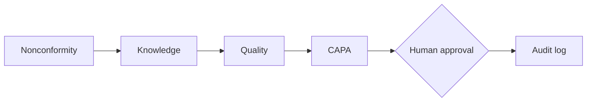

# Expertium: a verifiable industrial knowledge engine

Expertium turns a manufacturing nonconformity into a traceable quality record: answers grounded in cited procedures, a proposed corrective action, human approval, and a tamper-evident audit log.

Built solo by Luis Herrera (Peru) for the Meta Global AI Developer Hackathon, Indie track.

**Live demo:** TODO · **3-minute video:** TODO

## The problem

TODO: 1–2 sentences. Who raises a nonconformity, why finding the right procedure, deciding the action and leaving auditor-ready evidence is slow and hard to trace today.

## How it works

Four agents share one model, Muse Spark 1.3 on Meta Model API, with structured outputs:

1. **Knowledge** finds the applicable procedure and cites the source section.
2. **Quality** checks the case against the retrieved criteria.
3. **CAPA** proposes corrective and preventive actions with an owner and a due date, then waits for human approval.
4. **Audit** records decisions, sources and approvals in a hash-chained quality record.

**Example case:** TODO: one real demo case, from input to final record, in 3–4 lines (add a screenshot).

## Measured results

Averages over TODO demo cases:

| Metric | Result |
|---|---|
| Cost per case | $TODO |
| Latency per agent step | TODO s |
| Backend tests | TODO passing (`cd backend && pytest`) |

## Run locally

1. Copy `.env.example` to `.env` and add your Meta Model API key (server-side only, never committed).
2. Follow `backend/README.md` and `frontend/README.md`.
3. Demo data is seeded on startup from `backend/app/db.py`.

## What's new compared to previous work

- **Before the event:** the concept and design (a private MVP built before the event, and the author's master's thesis proposal).
- **During the hackathon:** TODO: list 3–5 concrete things built (e.g. each agent, structured outputs, hash-chained audit, approval flow, frontend integration). All code in this repository was written during the event.
- **Built with** Muse Code and Muse Spark 1.3 (Meta Model API).

## Limitations and roadmap

Single organization and demo data only. Every proposed action requires human approval by design, because model outputs can be wrong. Next: multi-organization support, visual inspection with SAM 3.1, and industrial pilots.
